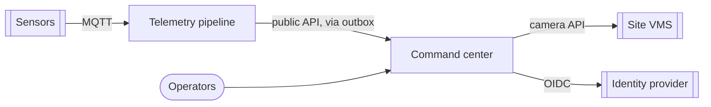

# Architecture Decisions

[](https://github.com/truongtankhanh/architecture-decisions/actions/workflows/check.yml)


The design record of a campus operations platform: why it is split the way it is, how its
systems talk to each other, how people and services are authenticated, where it runs, and what
every service must expose to be operable. Decisions that cross system boundaries live here;
each system keeps its own records for its internals.

| System                                                                             | What it does                                                                                                                                                        |
| ---------------------------------------------------------------------------------- | ------------------------------------------------------------------------------------------------------------------------------------------------------------------- |
| [ops-command-center](https://github.com/truongtankhanh/ops-command-center)         | Live incidents on a campus map with camera video, for control rooms                                                                                                 |
| [iot-telemetry-pipeline](https://github.com/truongtankhanh/iot-telemetry-pipeline) | Sensor data over MQTT into PostgreSQL, rules, alerts → incidents                                                                                                    |
| [claude-code-pipelines](https://github.com/truongtankhanh/claude-code-pipelines)   | The AI-assisted delivery workflow both are built with                                                                                                               |
| [platform-aws](https://github.com/truongtankhanh/platform-aws)                     | Both systems on AWS as CDK code: Fargate, RDS, IoT Core, CloudFront ([ADR-0012](decisions/0012-offer-an-aws-deployment-where-the-operator-allows-cloud-hosting.md)) |

The reference site, **Langbiang Tech Campus**, is fictional; the decisions are the kind a real
deployment forces.



**Start here:** [platform architecture](docs/platform.md) — C4 context, containers, the
cross-system flow, deployment, quality targets and the risk register.

## Platform decisions

<!-- adr-index:start -->

| ADR                                                                                       | Decision                                                        | Status                 |
| ----------------------------------------------------------------------------------------- | --------------------------------------------------------------- | ---------------------- |
| [0001](decisions/0001-record-platform-decisions-separately-from-system-decisions.md)      | Record platform decisions separately from system decisions      | Accepted               |
| [0002](decisions/0002-one-repository-per-system-monorepo-inside.md)                       | One repository per system, a monorepo inside each               | Accepted               |
| [0003](decisions/0003-systems-integrate-through-public-apis-never-a-shared-database.md)   | Systems integrate through public APIs, never a shared database  | Accepted               |
| [0004](decisions/0004-openapi-is-the-contract-between-systems.md)                         | OpenAPI is the contract between systems                         | Accepted               |
| [0005](decisions/0005-single-sign-on-for-identity-roles-owned-by-the-platform.md)         | Single sign-on for identity, roles owned by the platform        | Accepted               |
| [0006](decisions/0006-service-to-service-authentication.md)                               | Service-to-service authentication                               | Accepted               |
| [0007](decisions/0007-compose-on-a-single-host-kubernetes-only-where-scale-needs-it.md)   | Compose on a single host; Kubernetes only where scale needs it  | Accepted               |
| [0008](decisions/0008-connect-to-cameras-directly-over-onvif-and-rtsp.md)                 | ~~Connect to cameras directly over ONVIF and RTSP~~             | Superseded by ADR-0009 |
| [0009](decisions/0009-reach-cameras-through-the-site-s-video-management-system.md)        | Reach cameras through the site's video management system        | Accepted               |
| [0010](decisions/0010-an-observability-baseline-every-service-meets.md)                   | An observability baseline every service meets                   | Accepted               |
| [0011](decisions/0011-ai-assisted-delivery-with-human-review-gates.md)                    | AI-assisted delivery with human review gates                    | Accepted               |
| [0012](decisions/0012-offer-an-aws-deployment-where-the-operator-allows-cloud-hosting.md) | Offer an AWS deployment where the operator allows cloud hosting | Accepted               |

<!-- adr-index:end -->

Two records worth reading together: [ADR-0008](decisions/0008-connect-to-cameras-directly-over-onvif-and-rtsp.md)
was accepted on an assumption about the site's network, and
[ADR-0009](decisions/0009-reach-cameras-through-the-site-s-video-management-system.md) replaced
it once the vendor's documentation showed the assumption was wrong. What keeps the reversal cheap is an
earlier, unrelated decision to keep camera access behind an adapter.

The records were published together, so they share a date; the order of the numbers is the
order in which the questions came up.

## System decisions

Choices each system can change on its own, kept in its repository.

| System             | Record                                                                                                                            | Decision                                                    |
| ------------------ | --------------------------------------------------------------------------------------------------------------------------------- | ----------------------------------------------------------- |
| Command center     | [0001](https://github.com/truongtankhanh/ops-command-center/blob/main/docs/adr/0001-monorepo-pnpm-turborepo.md)                   | Monorepo with pnpm workspaces and Turborepo                 |
| Command center     | [0002](https://github.com/truongtankhanh/ops-command-center/blob/main/docs/adr/0002-camera-source-adapter.md)                     | Camera access behind a `CameraSource` adapter               |
| Command center     | [0003](https://github.com/truongtankhanh/ops-command-center/blob/main/docs/adr/0003-realtime-domain-events-socketio.md)           | Domain events in-process, broadcast with Socket.IO          |
| Command center     | [0004](https://github.com/truongtankhanh/ops-command-center/blob/main/docs/adr/0004-postgres-typeorm-migrations.md)               | PostgreSQL with TypeORM, migrations only                    |
| Telemetry pipeline | [0001](https://github.com/truongtankhanh/iot-telemetry-pipeline/blob/main/docs/adr/0001-mqtt-shared-subscriptions.md)             | Scale ingest horizontally with MQTT 5 shared subscriptions  |
| Telemetry pipeline | [0002](https://github.com/truongtankhanh/iot-telemetry-pipeline/blob/main/docs/adr/0002-ack-on-receipt-with-bounded-loss.md)      | Acknowledge on receipt; bound and measure the loss window   |
| Telemetry pipeline | [0003](https://github.com/truongtankhanh/iot-telemetry-pipeline/blob/main/docs/adr/0003-plain-postgres-partitions-and-rollups.md) | Plain PostgreSQL: daily partitions and write-time rollups   |
| Telemetry pipeline | [0004](https://github.com/truongtankhanh/iot-telemetry-pipeline/blob/main/docs/adr/0004-rules-with-hysteresis.md)                 | Threshold rules with consecutive breaches and hysteresis    |
| Telemetry pipeline | [0005](https://github.com/truongtankhanh/iot-telemetry-pipeline/blob/main/docs/adr/0005-alert-outbox.md)                          | Deliver alerts through a transactional outbox               |
| Delivery workflow  | [design notes](https://github.com/truongtankhanh/claude-code-pipelines/blob/main/docs/design.md)                                  | Staged pipelines, artifacts on disk, the tool never commits |

## How decisions are made

[The process](docs/process.md) covers which level a decision belongs to, when a record is worth
writing, the lifecycle (Proposed → Accepted → Superseded or Deprecated), and review. New records start from
[the template](templates/adr.md) and are reviewed against the
[design review checklist](templates/design-review-checklist.md).

```bash
npm install
npm run adr:new -- "Title of the decision"          # next number, from the template, index updated
npm run adr:new -- "New approach" --supersedes 8    # links both records
npm run check                                       # what CI runs
```

CI rejects gaps in numbering, unknown statuses, one-sided supersession links, sections missing
or out of order, broken relative links, and an index that does not match the records.

## License

[MIT](LICENSE) © Trương Tấn Khánh
