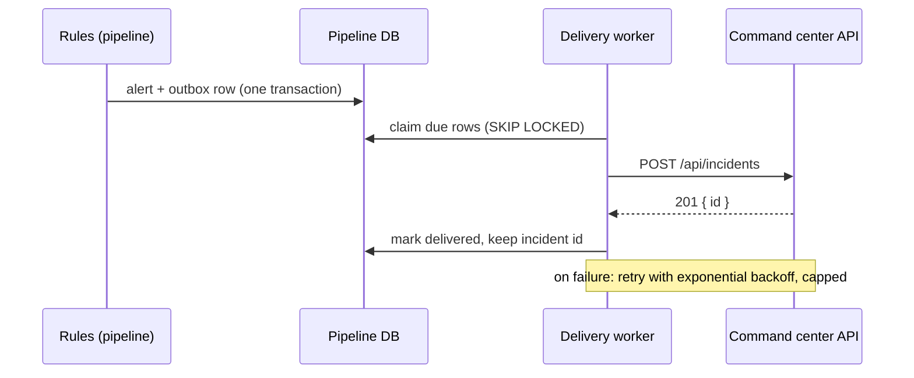

# ADR-0003: Systems integrate through public APIs, never a shared database

- **Status:** Accepted
- **Date:** 2026-10-01
- **Deciders:** Platform lead

## Context

The first integration: when a sensor rule fires (a server room above 27 °C for three readings),
the command center must show an incident, and resolve it when the reading recovers. More will
follow — access control events, building management alarms.

Both systems run PostgreSQL, often on the same host at a site. That makes the shortest path
tempting: the pipeline writes straight into the command center's `incident` table.

The command center enforces rules on incidents — valid transitions, a timeline entry for every
change, real-time broadcast to consoles after commit. Those rules live in its application
code, not in the database.

## Options

1. **Shared database** — the pipeline inserts incidents directly. Fastest to build. Bypasses
   every rule above: no timeline, no broadcast, and the command center can no longer change its
   own schema without breaking a system it does not own.
2. **A message broker between systems** (Kafka, RabbitMQ) — decoupled in time, replayable. A
   new piece of infrastructure to run at every on-prem site, for one producer and one consumer.
3. **The producer calls the consumer's public API, reliably** — the pipeline records "deliver
   this" in its own database in the same transaction as the alert (an outbox), and a worker
   calls the command center's REST API with retries.

## Decision

Option 3, as a platform rule:

- **A system's database is private to that system.** No other system reads or writes it, even
  when the credentials are at hand.
- **Integration goes through the owner's published API.** The owner's rules apply to every
  caller, including other systems.
- **The calling side owns reliability.** It writes its intent to an outbox in the same
  transaction as the state change and delivers with backoff, so the other system being down
  delays the effect but never loses it.

The first implementation is the telemetry pipeline's alert outbox
([iot-telemetry-pipeline ADR-0005](https://github.com/truongtankhanh/iot-telemetry-pipeline/blob/main/docs/adr/0005-alert-outbox.md)):
`POST /api/incidents` on open, `POST /api/incidents/:id/resolve` on clear.

## Consequences

- Incidents raised by sensors follow exactly the same rules, timeline and real-time path as
  those raised by operators.
- Delivery is at least once. A retry after a timeout can create a duplicate until the command
  center accepts an idempotency key — owed by the command center (pipeline roadmap ITP-14).
- Each system can migrate its schema freely; the API is the only thing it must keep stable
  ([ADR-0004](0004-openapi-is-the-contract-between-systems.md)).
- Calls between systems need authentication, which the command center does not have yet
  ([ADR-0006](0006-service-to-service-authentication.md), Proposed).

## Revisit when

The same event needs three or more consumers, or consumers need to replay history. That is the
point where a broker earns its operational cost.
