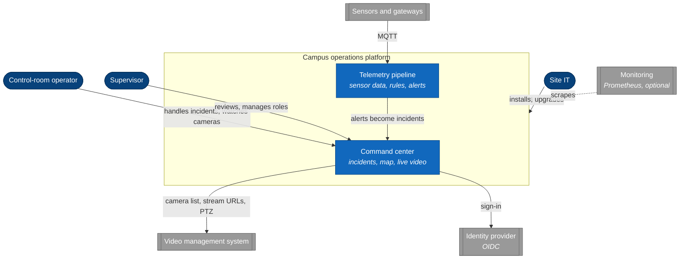
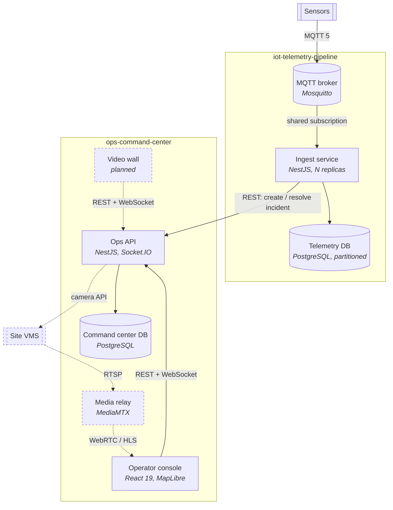
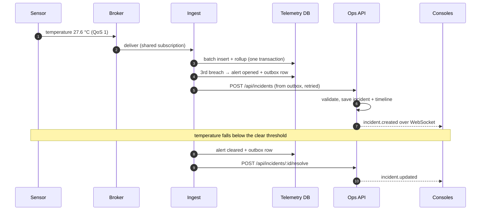
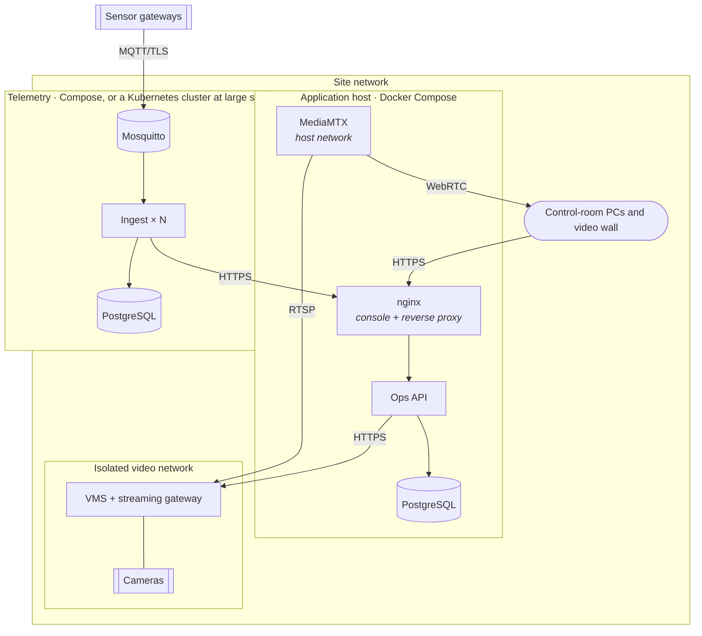

# Platform architecture

The views below follow the [C4 model](https://c4model.com): context, containers, deployment,
plus the one runtime flow that crosses system boundaries. Each system's own architecture
document goes one level deeper.

The reference site is **Langbiang Tech Campus**, a fictional technology campus. All data,
devices and names are synthetic.

## 1. System context

Who uses the platform and what it depends on.

| Relationship               | Decided in                                                                                     |
| -------------------------- | ---------------------------------------------------------------------------------------------- |
| Telemetry → command center | [ADR-0003](../decisions/0003-systems-integrate-through-public-apis-never-a-shared-database.md) |
| Command center → VMS       | [ADR-0009](../decisions/0009-reach-cameras-through-the-site-s-video-management-system.md)      |
| Users → identity provider  | [ADR-0005](../decisions/0005-single-sign-on-for-identity-roles-owned-by-the-platform.md)       |
| Monitoring                 | [ADR-0010](../decisions/0010-an-observability-baseline-every-service-meets.md)                 |

## 2. Containers

Every box is a separately running process; dashed boxes and arrows are planned (video wall,
real video through the site's VMS — OCC-15, OCC-28). The outer boundaries are repositories
([ADR-0002](../decisions/0002-one-repository-per-system-monorepo-inside.md)); nothing crosses a
boundary except HTTP calls through a published API.

Data ownership:

| Data                                  | Owner              | Others get it through                   |
| ------------------------------------- | ------------------ | --------------------------------------- |
| Incidents, timeline, zones on the map | Command center     | `GET/POST /api/incidents`, `/api/zones` |
| Users' roles and permissions          | Command center     | not shared                              |
| Readings, rollups, alerts             | Telemetry pipeline | `GET /api/devices/:id/readings`, alerts |
| Device registry and rules             | Telemetry pipeline | reviewed as code in its repository      |
| Cameras, credentials, video           | Site's VMS         | VMS API, synchronised by command center |
| Staff identities                      | Site's IdP         | OIDC sign-in                            |

## 3. The cross-system flow: a sensor reading becomes an incident

Each step's guarantee:

| Step                | Guarantee                                                          | Where it is decided                                                                                                                       |
| ------------------- | ------------------------------------------------------------------ | ----------------------------------------------------------------------------------------------------------------------------------------- |
| Sensor → ingest     | at least once; gaps counted per device                             | [ITP ADR-0002](https://github.com/truongtankhanh/iot-telemetry-pipeline/blob/main/docs/adr/0002-ack-on-receipt-with-bounded-loss.md)      |
| Storage             | no duplicates; rollups from rows actually inserted                 | [ITP ADR-0003](https://github.com/truongtankhanh/iot-telemetry-pipeline/blob/main/docs/adr/0003-plain-postgres-partitions-and-rollups.md) |
| Alert               | opens after N consecutive breaches, clears below a lower threshold | [ITP ADR-0004](https://github.com/truongtankhanh/iot-telemetry-pipeline/blob/main/docs/adr/0004-rules-with-hysteresis.md)                 |
| Alert → incident    | at least once, with backoff; survives either side restarting       | [ADR-0003](../decisions/0003-systems-integrate-through-public-apis-never-a-shared-database.md)                                            |
| Incident → consoles | after commit; consoles refetch once on reconnect                   | [OCC ADR-0003](https://github.com/truongtankhanh/ops-command-center/blob/main/docs/adr/0003-realtime-domain-events-socketio.md)           |

## 4. Deployment at one site

Rules every service follows, whatever it runs on
([ADR-0007](../decisions/0007-compose-on-a-single-host-kubernetes-only-where-scale-needs-it.md)):
configuration from validated environment variables, migrations applied on start, graceful drain
on `SIGTERM`, and the observability baseline of
[ADR-0010](../decisions/0010-an-observability-baseline-every-service-meets.md) (adoption in
progress — see its table).

The same images also run on AWS for operators that allow cloud hosting
([ADR-0012](../decisions/0012-offer-an-aws-deployment-where-the-operator-allows-cloud-hosting.md));
[platform-aws](https://github.com/truongtankhanh/platform-aws) describes that deployment.

## 5. Quality attributes

| Attribute     | Target                                                          | How it is met                                                                                       |
| ------------- | --------------------------------------------------------------- | --------------------------------------------------------------------------------------------------- |
| Freshness     | An incident appears on every console within 1 s of being stored | Domain events after commit, pushed over WebSocket                                                   |
| Alert latency | A breach becomes an incident within seconds of the Nth reading  | 250 ms flush, 1 s delivery poll                                                                     |
| Throughput    | Campus-wide sensors on one ingest replica, with headroom        | ≈ 10 000 msg/s measured on 2 vCPU; more replicas via shared subs                                    |
| Completeness  | Data loss is measured, not assumed                              | Per-device sequence numbers, gap metric                                                             |
| Availability  | Ingest keeps running when the command center is down            | Outbox; no synchronous dependency                                                                   |
| Operability   | Site IT can install and upgrade from a runbook                  | Compose by default, self-migrating services, baseline endpoints                                     |
| Security      | No passwords stored; least privilege by default                 | OIDC sign-in through Keycloak, platform-owned roles (OCC-21/22); a service account for the pipeline |

## 6. Risks and technical debt

Reviewed at each milestone. Owner is the system's lead unless noted.

| #   | Risk / debt                                                          | Impact                                         | Mitigation / next step                                                                                                                      |
| --- | -------------------------------------------------------------------- | ---------------------------------------------- | ------------------------------------------------------------------------------------------------------------------------------------------- |
| R1  | Pipeline deliveries depend on Keycloak as well as the command center | A Keycloak outage delays incidents from alerts | Outbox retries with backoff: an outage delays incidents and loses none ([ADR-0006](../decisions/0006-service-to-service-authentication.md)) |
| R2  | ~~Retried incident creation can duplicate an incident~~              | —                                              | Resolved: the pipeline sends the alert id as `Idempotency-Key` (ITP-14)                                                                     |
| R3  | Command center is a single host                                      | Host failure = outage until restore            | Rehearsed restore onto a standby host; revisit per ADR-0007                                                                                 |
| R4  | The pipeline has no correlation ids yet                              | Cross-system failures are slow to trace        | ADR-0010 baseline; the command center has them (OCC-23)                                                                                     |
| R5  | Consumer's fake of the command center API can drift                  | Integration breaks at a site, not in CI        | Contract tests against the published OpenAPI when a second consumer appears (ADR-0004)                                                      |
| R6  | Broker queue limits silently drop QoS 1 messages under bursts        | Data loss with no error logged                 | Explicit limits in broker config; alert on `telemetry_sequence_gaps_total`                                                                  |
| R7  | VMS dependency for all video                                         | VMS outage = no live video                     | Accepted (same for every VMS client); camera tiles show a clear "video unavailable" state                                                   |
