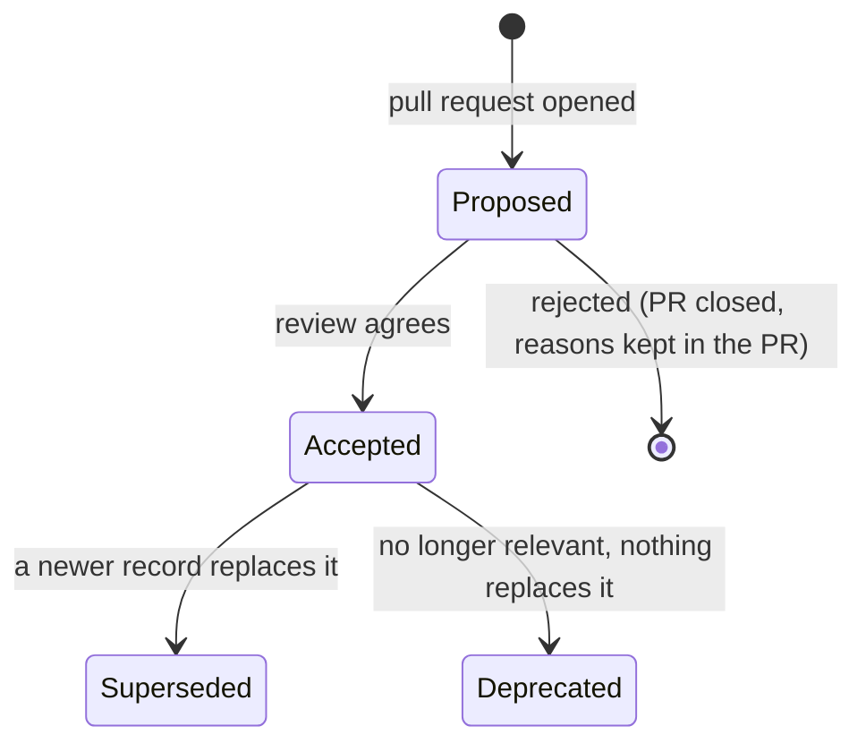

# How decisions are made and recorded

## Two levels of records

| Level        | Lives in                                       | Covers                                                                            |
| ------------ | ---------------------------------------------- | --------------------------------------------------------------------------------- |
| **Platform** | this repository, [`decisions/`](../decisions/) | Anything that crosses a system boundary or sets a rule every system follows       |
| **System**   | `docs/adr/` in each system's repository        | Choices inside one system that its own team can change without asking anyone else |

The test for which level: _if this decision changed, would another system's code or another
team's runbook have to change too?_ If yes, it is a platform decision. A system ADR may cite a
platform ADR as a constraint; a platform ADR never depends on a system ADR's internals.

## When to write one

Write a record when a decision is **expensive to reverse** or **likely to be questioned later**:

- a new system, data store, protocol or external dependency
- a boundary moving: which system owns which data
- a rule every system must follow (identity, observability, deployment)
- a constraint discovered from outside — a vendor's documentation, a client's network policy —
  that rules out something we had planned

Do not write one for choices a linter, a code review or a library default already settles.

## Lifecycle



- **Accepted records are not edited** except for typos, links and status. If the decision
  changes, write a new record that supersedes the old one; the old one stays as history.
- **Proposed records are allowed to be unfinished.** An open question written down with its
  options is more useful than a decision made silently in a meeting.
- Superseding is recorded on both sides. `npm run adr:new -- "Title" --supersedes 8` does this,
  and CI rejects a one-sided link.

## Review

1. Open a pull request with the record in **Proposed** status.
2. The reviewer works through the [design review checklist](../templates/design-review-checklist.md).
3. Decisions that change a client-facing contract or deployment are walked through with the
   project manager before acceptance, because they become commitments to the client.
4. On agreement, change the status to **Accepted** in the same pull request and merge.

The author owns the follow-up tickets the Consequences section creates.

## Writing style

- **Context states facts, Decision states commitments.** "The VMS exposes an OpenAPI" is
  context; "we integrate through the VMS" is a decision.
- **Name the options you rejected and why.** The rejected options are what a future reader
  will propose again.
- **Every record has negative consequences.** If none come to mind, the analysis is not done.
- **Short beats complete.** One screen is the target; link to a design document for detail.

## Tooling

```bash
npm run adr:new -- "Reach cameras through the site's VMS" --supersedes 8
npm run adr:index     # regenerate the index in README.md
npm run check         # numbering, statuses, supersession links, broken links, index
```
